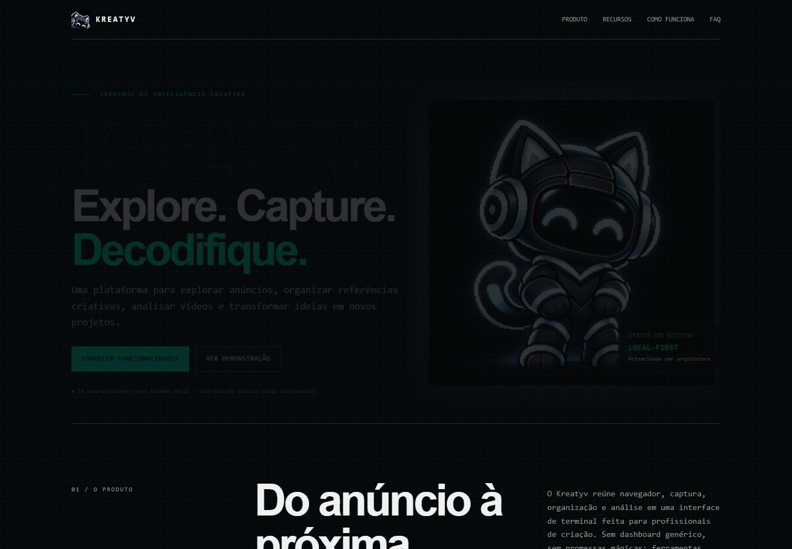

# Kreatyv Landing Page

Landing page oficial e independente do Kreatyv. Site estático em HTML, CSS e JavaScript, preparado para GitHub Pages.

Este repositório não contém o código do aplicativo Electron, instaladores, licenças de ativação, chaves, bancos de dados ou mídias privadas.

## Visualização local

```powershell
python -m http.server 8080
```

Acesse `http://localhost:8080`.

© 2026 Cairo Costa. Todos os direitos reservados.


## Visão rápida do projeto

**Finalidade:** apresentar o Kreatyv, um terminal de inteligência criativa para explorar anúncios, organizar referências e analisar conteúdos em um fluxo voltado a pesquisa visual. Este repositório é **somente a landing page**, não o aplicativo Windows.

**Tecnologias:** HTML, CSS e JavaScript sem build obrigatório. Entrada em `index.html`; estilos em `styles.css` e `overrides.css`; interação em `script.js`.

### Capturas reais do projeto




As imagens acima já estão versionadas em `screenshots/`. Antes de qualquer publicação, confira que os textos e a demonstração correspondem ao produto atual.

### Estrutura útil

- `assets/`: identidade e recursos visuais.
- `robots.txt` e `.nojekyll`: suporte à publicação estática.
- `screenshots/`: material visual já disponível.
